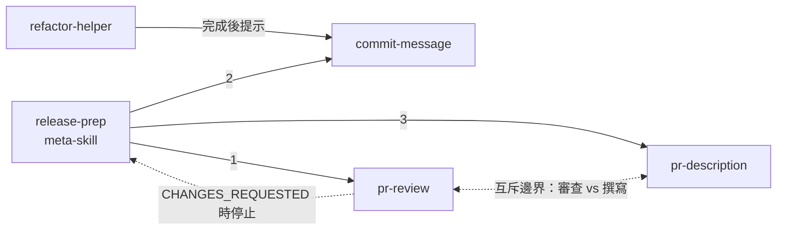

# 專案 Skills 一覽

| Skill | 用途 | 邊界（Not for） | 接棒 |
| --- | --- | --- | --- |
| `pr-review` | **審查**程式碼：找 bug、安全、錯誤處理、測試缺口 | 不寫 PR 說明、不寫 commit 訊息 | — |
| `pr-description` | **撰寫** PR 標題與說明文字 | 不審查程式碼 | — |
| `commit-message` | 依 staged 變更寫 commit 訊息 | 不寫 PR 說明、不審查 | — |
| `refactor-helper` | 不改行為的重構 | 不找 bug、不加功能 | 完成後提示 → `commit-message` |
| `release-prep` | meta-skill：發版前整套流程 | 只要單一步驟時不用 | 依序呼叫 `pr-review` → `commit-message` → `pr-description` |

## 邊界設計原則

- `pr-review` 與 `pr-description` 原本都寫「處理 PR／整理 PR」、觸發條件都是「提到 PR」→ 必互搶。
- 修正後以**動詞**切分：審查（review／check／有沒有問題）vs 撰寫（write／draft／說明）。
- 每個 description 結尾都有「Not for：…請改用 X」，把誤觸發導回正確 skill。

## 接棒關係

