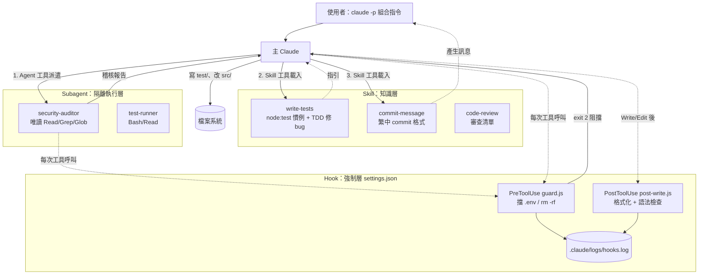

# ARCHITECTURE — 三支柱整合（Skill／Subagent／Hook）

《Claude Code Architect》第 19 章演練。本專案用一個小型訂單模組（`src/order.js`）示範三種擴充機制如何分工。

## 決策表：什麼情況用哪一個？

| 機制 | 判斷問題（先問自己） | 典型例子 | 本專案對應檔案 |
| --- | --- | --- | --- |
| **Skill** | 「這是一套**可重用的做法／知識**，希望 Claude 在需要時自動載入、在主對話裡照著做嗎？」 | 公司的 commit 格式、測試慣例、審查清單 | `.claude/skills/commit-message/SKILL.md` `.claude/skills/code-review/SKILL.md` `.claude/skills/write-tests/SKILL.md` |
| **Subagent** | 「這件事需要**獨立 context**、**限制工具權限**，或想讓它平行／不污染主對話嗎？」 | 唯讀安全稽核、跑一大堆測試只回摘要 | `.claude/agents/security-auditor.md`（只有 Read/Grep/Glob） `.claude/agents/test-runner.md`（Bash/Read） |
| **Hook** | 「這條規則是否**每次都必須發生、不能靠 AI 記得**？」（確定性、強制性） | 擋 `.env`／`rm -rf`、寫檔後自動格式化、稽核 log | `.claude/settings.json` `.claude/hooks/guard.js`（PreToolUse） `.claude/hooks/post-write.js`（PostToolUse） `.claude/hooks/log.js`（共用 log） |

### 一句話口訣

- **Skill = 教 Claude「怎麼做」**（知識，模型決定何時用）
- **Subagent = 派別人「去做」**（隔離的 context 與權限）
- **Hook = 系統「一定會做」**（程式碼強制，不經模型判斷）

### 常見誤用

| 誤用 | 為什麼不好 | 正確做法 |
| --- | --- | --- |
| 把「禁止讀 .env」寫在 Skill／CLAUDE.md | 模型可能忘記或被說服 | 寫成 PreToolUse hook（exit 2 阻擋） |
| 把 commit 格式做成 subagent | 只是格式知識，不需隔離 context，反而多花 token | 做成 Skill |
| 讓安全稽核在主對話直接做 | 會把大量檔案內容塞進主 context，且有寫檔權限 | 唯讀 subagent，只回報表格 |

## 協作流程圖

## 設計決策

1. **Hook 用 Node 寫**：Windows／macOS／Linux 都能跑，且專案本身就是 JS，零額外依賴。
2. **沒有 prettier**：本機未安裝，PostToolUse 改做最小格式化（去行尾空白、補結尾換行）＋ `node --check` 語法檢查；語法錯時 exit 2 讓 Claude 自己修。
3. **security-auditor 用 haiku**：唯讀 pattern 搜尋不需強推理，省成本。
4. **commit-message 只產生訊息、不 commit**：保留人類最後把關。
5. **code-review skill 與內建 `/code-review` 同名**：照書上命名；專案層 skill 會與內建指令並存，觸發時以描述判斷（見 NOTES.md）。
